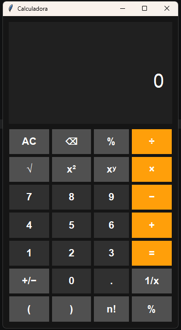

# Calculadora Python

Calculadora desenvolvida em Python com interface gráfica utilizando Tkinter.

## Funcionalidades

- Soma
- Subtração
- Multiplicação
- Divisão
- Porcentagem
- Raiz quadrada
- Potenciação
- Fatorial

## Tecnologias Utilizadas

- Python 3
- Tkinter
- Math

## Como Executar

1. Clone o repositório

```bash
git clone https://github.com/MatheusLima05/calculadora-python.git
cd calculadora-python
py calculadora.py
```

## Objetivo

Projeto de estudo para praticar Python, criação de interfaces gráficas, tratamento de erros e operações matemáticas.

## 📸 Demonstração



## Autor

Matheus Lima
